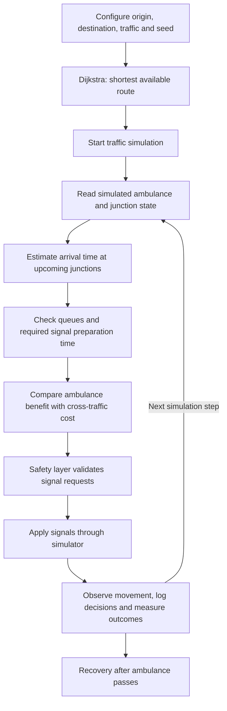

<div align="center">

# 🚑 PEGC — Predictive Emergency Green Corridor

### Predict the arrival. Prepare the signal. Measure the impact.

**Nexora Titans · Katathon 6.0 · Problem Statement 102**  
**Emergency-Corridor Traffic Simulator**  
*Smart Cities, Mobility and Resilient Infrastructure*

**A simulation and experimentation platform for safer, smarter emergency-vehicle signal priority.**

</div>

---

## 🌟 The idea

When an ambulance approaches a busy junction, simply turning its light green is not always enough. Vehicles may already be queued in its lane, other approaches may have long waits, and abrupt signal changes can be unsafe.

**PEGC (Predictive Emergency Green Corridor)** tests a more thoughtful approach: **anticipate an emergency vehicle's arrival, prepare upcoming traffic signals early, account for queue clearance and cross-traffic costs, enforce safe signal transitions, and help normal traffic recover afterward.**

Instead of making unverified claims about saving lives or deploying on real streets, PEGC lets users **simulate, observe, compare and measure** emergency-priority strategies under controlled traffic conditions.

> **Important:** The PEGC website is a **traffic simulator and research/demo dashboard**. It does not access live city traffic lights, real ambulances, CCTV or GPS. All vehicle movements and traffic measurements come from simulation.

## ✨ Features

### 🚦 Predictive emergency green corridor

- **Rule-based ETA estimation:** estimate when an ambulance will reach upcoming junctions from its simulated position, speed and route.
- **Two-junction lookahead:** prepare traffic signals before the ambulance reaches them.
- **Queue-aware preparation:** account for vehicles that must clear ahead of the ambulance.
- **Cross-traffic impact evaluation:** weigh expected ambulance time saved against delays and spillback imposed on other vehicles.
- **Signal safety layer:** enforce minimum green, yellow and all-red phases, emergency hold limits and maximum-wait protection.
- **Traffic recovery:** prioritize restoring regular flow after the emergency vehicle passes.
- **Decision logs:** inspect when the controller requests, declines, delays or releases priority.

**Future GPS integration:** Today's ETA uses **simulated ambulance position and movement**, not GPS. A future real-world version could integrate live ambulance GPS, traffic sensors and validated traffic-signal infrastructure to update ETA from actual vehicle movement. GPS integration is **not implemented in this prototype**.

### 🗺️ Automatic route selection

- Enter an **origin and destination**; the ambulance automatically follows a **shortest-distance available route** calculated using Dijkstra's algorithm.
- Configure blocked road segments **before a run**; routing avoids those segments where an alternative path exists.
- The controller coordinates signals along the selected route.

**Current scope:** Routes are selected by distance and configured road availability—not by measured congestion. **Traffic-aware fastest-route recommendation and automatic mid-journey rerouting are not implemented.**

### 🚑 Multiple emergency vehicles and live controls — Step 10

In **SUMO backend mode**, PEGC supports:

- **Up to three ambulances** in a single simulation, with configurable origins, destinations and departure times.
- **Live dispatch:** insert an additional ambulance while a simulation is running (subject to the three-ambulance cap).
- **Live traffic changes:** adjust traffic density while the SUMO simulation is running.
- **Priority-conflict handling:** coordinate requests when multiple ambulances need incompatible signal directions.
- **Individual ambulance analytics:** travel time, stops and delay, plus aggregate mean and worst delay when multiple ambulances are present.
- **Visual identification and camera follow:** distinguish ambulances by colour and follow a chosen vehicle.
- **Live-change flagging:** runs changed through dispatch or traffic controls are marked as modified and **are not treated as clean benchmark comparisons**.

These capabilities are **specific to SUMO mode**. The separate browser mini-simulator remains available and retains its existing behaviour.

### 🖥️ Interactive simulator website

| Area | What you can do |
|---|---|
| **Command Centre** | Enter the simulator and view the city overview. |
| **Configure** | Choose route endpoints, traffic density, seed, blocked roads and—when using SUMO—multiple ambulance settings. |
| **Watch** | Visualize vehicles and signals, follow ambulances, inspect decision logs and view run metrics; in SUMO mode, use live traffic and dispatch controls. |
| **Compare** | Run signal strategies under controlled, comparable scenarios and inspect performance differences. |
| **Stress Test** | Test challenging traffic and preconfigured road-blockage conditions. |

The interface offers **two distinct simulation sources**:

1. **Browser mini-simulator:** JavaScript-based, runs locally in the browser and is useful for quick demonstrations.
2. **SUMO backend:** SUMO traffic simulation controlled by Python through TraCI; frames and results are delivered to the React dashboard through FastAPI and WebSockets.

**Results from the two engines are labelled separately and must not be mixed.** A deployed frontend by itself does **not** guarantee the SUMO backend is online.

---

## 🧠 How PEGC works



PEGC's **signal decisions are rule-based and cost-based**, not the output of a trained machine-learning model. The project may have used AI-assisted development tools, but **ML-based ETA prediction is not part of the completed prototype**.

### Safety rules

The simulation controller enforces a **7-second minimum green**, **3-second yellow**, **2-second all-red**, **25-second emergency hold cap** and **90-second maximum-wait protection**. Requests must pass the safety layer; a priority request is not permission to create conflicting green movements. These are **prototype simulation rules**, not a certification for operating public traffic signals.

---

## ⚖️ Signal strategies and fair comparison

PEGC is not only a visualization: it is an **experimental platform** for comparing different control policies.

| Strategy | Approach | Purpose |
|---|---|---|
| **A — Fixed-Time** | Runs a predefined traffic-signal schedule and ignores emergency vehicles. | Baseline. |
| **B — Basic Emergency Priority** | Requests green for the ambulance's direction when it comes within **120 m** of its next junction, without PEGC's full cross-traffic evaluation. | Simple emergency-priority baseline. |
| **C — PEGC** | Predicts arrival, considers queues and cross-traffic cost, requests safe early changes and manages recovery. | Main proposed controller. |
| **C1 — No Queue Awareness** | Variant of C without queue-aware timing. | Tests the contribution of queue awareness. |
| **C2 — No Recovery** | Variant of C without the recovery behaviour. | Tests the contribution of recovery. |
| **C3 — Cross-Traffic Fairness Variant** | SUMO-side variant of C with an adjusted cross-street longest-wait penalty. | Studies the ambulance-speed versus fairness trade-off. |

### How comparisons stay fair

For a clean comparison, each strategy is run with the **same road network, origin/destination, selected route, road blockages, traffic demand, random seed and calibrated SUMO traffic settings**. Only the **signal-control strategy** changes. That means differences in ambulance travel time and other traffic outcomes can be attributed more meaningfully to the controller, rather than to unrelated changes in the scenario.

The comparison uses repeatable random seeds. **Seeds 1–5** were used for tuning and **seeds 101–110** were held out for reporting. The evaluation spans **three traffic densities × two routes × open/blocked road configurations**, with repeated seeds and multiple strategies. SUMO's traffic presets were calibrated before evaluation; the **high-traffic preset remains intentionally oversaturated** as a stress condition.

**Live-edited runs are excluded from clean A/B/C comparisons.** They are useful for demonstration and exploration, but a mid-run traffic or dispatch change would undermine an identical-scenario benchmark.

### What is measured?

- **Ambulance travel time:** departure-to-arrival time; lower is better.
- **Ambulance stops and delay:** interruption and travel-time overhead.
- **Average ordinary-vehicle wait:** cost to other road users.
- **Longest wait and 95th-percentile wait:** fairness and worst-case delay indicators.
- **Maximum queue length:** congestion at approaches.
- **Throughput:** vehicles completing their trips per unit time.
- **Recovery behaviour:** whether and when traffic returns toward a defined baseline.
- **Safety violations:** recorded breaches of the simulator's safety checks.

### 📊 Reported SUMO evaluation

The team's recorded **900-run SUMO evaluation** found:

| Finding | Reported result |
|---|---|
| Ambulance travel time, **C vs A** | Approximately **32–51% lower** across reported test conditions |
| Ambulance travel time, **C vs B** | Approximately **5–15 seconds faster** |
| Recorded simulation safety violations | **0** across the reported 900 runs |
| Cross-street trade-off | Longest wait was **up to about 27% higher** in some conditions |

These are **team-reported simulation results**, not independently verified real-road outcomes. Some high-traffic baseline runs did not finish before the observation limit; the analysis documents finished counts and sensitivity checks rather than treating missing travel times as zero. Zero recorded simulation violations does **not** establish real-world safety.

The experiment scripts, CSV outputs and analysis utilities are under `backend/experiments/`; the frozen Step 5 baseline is under `baselines/step5/`. The C3 tuning and later evaluation are separate from that original frozen baseline.

---

## 🏗️ Technology stack

| Layer | Technology | Role |
|---|---|---|
| Frontend | **React 18, Vite 5, JavaScript, CSS** | Interactive simulator website and controls |
| Rendering | **HTML Canvas 2D** | Road network, vehicle and signal visualization |
| Browser engine | **JavaScript ES modules, Web Workers** | Self-contained browser simulation, comparisons and stress runs |
| Backend | **Python 3.10+, FastAPI, Uvicorn, Pydantic** | Scenario validation, run management and API |
| Live communication | **WebSockets** | Stream SUMO frames, vehicle states and decision logs |
| Traffic simulation | **SUMO, TraCI, sumolib** | Vehicle movement, junction states and signal control |
| Algorithms | **Dijkstra; rule-based ETA; cost-based PEGC controller** | Routing, prediction and priority decisions |
| Testing and reporting | **pytest, Node.js tests, Matplotlib, CSV** | Regression tests and experimental analysis |
| Development | **Git, GitHub, GitHub Codespaces** | Source control and Linux-based SUMO environment |
| Frontend deployment | **Vercel** | Browser application hosting |

**No external live traffic, GPS or CCTV API is required.**

### Repository layout

```text
.
├── frontend/
│   ├── src/engine/        # Browser mini-simulator and strategies
│   ├── src/render/        # Canvas rendering and playback controller
│   ├── src/data/          # Browser/SUMO source adapter and API client
│   ├── src/ui/            # React dashboard screens and controls
│   ├── scripts/           # Regression and reference-data tools
│   └── package.json
├── backend/
│   ├── api/               # FastAPI app, run manager, WebSocket endpoints
│   ├── pegc_sumo/         # SUMO network, demand, routing, controllers, safety
│   ├── experiments/       # Calibration, batch runs, reports and charts
│   ├── tests/             # Python tests and regression fixtures
│   └── requirements.txt
└── baselines/step5/       # Frozen SUMO experiment baseline
```

---

## 🚀 Setup and run — Windows users (GitHub Codespaces recommended)

> **Why Codespaces?** The frontend works on Windows, but the team's Windows environment blocked SUMO executables. **GitHub Codespaces provides a Linux development environment** where the SUMO/Python backend can run without relying on a local Windows SUMO installation. The simplest reliable demo is to run **both frontend and backend inside the same Codespace**.

### Prerequisites

- A **GitHub account** with access to this repository and GitHub Codespaces.
- A modern browser such as Chrome or Edge.
- No local SUMO installation is needed when following the Codespaces instructions.

### Step 1 — Open the project in Codespaces

1. Open this GitHub repository.
2. Click **Code → Codespaces → Create codespace on main** (or open an existing Codespace).
3. Wait for the browser-based VS Code environment and terminal to load.
4. Confirm you are in the repository root, containing the `frontend/` and `backend/` folders:

```bash
pwd
ls
```

If your Codespace already has dependencies installed, you can skip the corresponding install commands below.

### Step 2 — Install and start the SUMO backend

Open **Terminal 1** in Codespaces:

```bash
cd backend
python3 -m venv .venv
source .venv/bin/activate
python -m pip install --upgrade pip
pip install -r requirements.txt
```

Check the Python/SUMO environment and API dependencies:

```bash
python -c "import traci, sumolib, fastapi; print('SUMO/TraCI/FastAPI imports OK')"
```

Start the backend **from inside `backend/`**:

```bash
uvicorn api.main:app --host 0.0.0.0 --port 8000
```

Leave this terminal running. In another terminal, check:

```bash
curl http://localhost:8000/api/health
```

You should receive JSON reporting the backend status and SUMO availability. **If `sumo_found` is false**, inspect the installed `eclipse-sumo` package and SUMO executable setup before proceeding; the API alone cannot simulate traffic without SUMO.

### Step 3 — Install and start the frontend

Open **Terminal 2** in the same Codespace:

```bash
cd frontend
npm install
npm run dev -- --host 0.0.0.0
```

Leave this terminal running. Vite normally uses **port 5173**.

### Step 4 — Forward the Codespaces ports

1. Open the **Ports** tab in the Codespaces VS Code interface.
2. Confirm **8000** (FastAPI) and **5173** (Vite) are forwarded; add them manually if necessary.
3. Copy the **forwarded HTTPS URL for port 8000**. It will resemble `https://YOUR-CODESPACE-NAME-8000.app.github.dev`.
4. Open the **forwarded URL for port 5173** in your browser.
5. In the PEGC frontend, use its **API address setting** to enter the **port-8000 HTTPS URL** (without a trailing `/`) and switch the source to **SUMO backend**.

**Important:** `http://localhost:8000` in a browser tab opened from a Windows laptop points to the **Windows laptop**, not automatically to the Codespace. Use the **forwarded Codespaces URL** when the frontend runs in your browser. Use an address accessible to that browser, and make sure your GitHub session has access to the forwarded port.

If you cannot find the API-address control in your current UI build, configure the frontend's supported `VITE_API_BASE` setting before starting Vite:

```bash
# In the frontend/ directory, replace the URL with YOUR forwarded port-8000 URL
export VITE_API_BASE="https://YOUR-CODESPACE-NAME-8000.app.github.dev"
npm run dev -- --host 0.0.0.0
```

The frontend also supports a locally saved API-base setting. **Never commit a personal Codespaces URL or access token to the repository.**

### Step 5 — Run a demonstration

1. Open **Configure** and choose an origin, destination, traffic preset and seed.
2. Choose **SUMO backend** as the simulation source.
3. Optionally configure **two or three ambulances** with different departure times.
4. Press **Launch** to watch the simulation and inspect the decision log.
5. During a SUMO Watch run, try changing traffic density or dispatching another ambulance (up to the three-ambulance cap).
6. After the run, inspect per-ambulance results and the run summary.
7. Open **Compare** to evaluate strategies using **clean, fixed scenarios**; use **Stress Test** for heavier traffic or blocked-road experiments.

**Note:** Compare and Stress Test are not live-dispatch experiments; they use controlled runs to preserve comparability. The backend processes jobs sequentially, so larger comparisons may take several minutes.

### Step 6 — Run tests and check the production build

In a backend terminal (with `.venv` activated):

```bash
cd backend
python -m pytest -q
```

In a separate frontend terminal:

```bash
cd frontend
npm run test:engine
npm run test:data
node scripts/baseline.mjs --check
npm run build
```

The baseline check confirms the saved **45 browser simulation results** still match. The exact pytest count can change as tests are added; success means the suite finishes without failures. Do not rerun the original 900-run evaluation just to start the website.

### Troubleshooting

| Symptom | What to check |
|---|---|
| `ModuleNotFoundError` for `traci`, `sumolib` or `fastapi` | Activate `backend/.venv`, then run `pip install -r requirements.txt` from `backend/`. |
| SUMO not found | Check the `eclipse-sumo` installation and the backend `/api/health` response. |
| Frontend says backend unreachable | Keep Uvicorn running; verify port **8000** is forwarded and use its **HTTPS Codespaces URL**, not Windows `localhost`. |
| WebSocket or CORS errors | Use the forwarded API origin, check port access and confirm the backend's allowed frontend origin configuration. |
| Blank or missing SUMO frames | Verify the selected source is SUMO, a run has actually launched and the backend terminal shows no errors. |
| Slow Compare/Stress Test | SUMO runs are queued and executed one at a time; use fewer seeds for a quick demo. |
| Browser mode works but SUMO mode does not | The two engines are separate; browser mode does not prove the Python/SUMO service is connected. |
| Local Windows SUMO fails to start | Use GitHub Codespaces as described above rather than changing system security policy. |

### Alternative: frontend-only preview on Windows

For the browser mini-simulator **without SUMO backend features**, install Node.js and run from PowerShell:

```powershell
cd frontend
npm install
npm run dev
```

Open the local Vite address shown in the terminal and select **Browser mini-simulator**. **Live multi-ambulance dispatch and live SUMO traffic changes require the Codespaces backend.**

---

## 🔌 API overview

The SUMO service exposes these endpoints:

| Endpoint | Purpose |
|---|---|
| `GET /api/health` | Check backend status and SUMO availability. |
| `POST /api/runs` | Start a scenario, optionally in live mode with multiple ambulances. |
| `GET /api/runs/{id}` | Read run status and summary. |
| `GET /api/compare` | Run controlled A/B/C comparisons. |
| `WS /ws/runs/{id}` | Receive simulation frames and final summary. |
| `POST /api/runs/{id}/traffic` | Change traffic in a live run. |
| `POST /api/runs/{id}/dispatch` | Dispatch an additional ambulance in a live run. |
| `POST /api/runs/{id}/cancel` | Cancel a supported queued or running live run. |

Interactive API documentation is available at **`/docs`** when the FastAPI backend is running.

---

## 🔭 Future possibilities

The Step 10 implementation is the **completed hackathon prototype**. Possible extensions, **not current features**, include:

- **Live GPS integration** to update ambulance position and arrival estimates using actual vehicle movement.
- **Traffic-aware route recommendations** and safe mid-journey rerouting based on real congestion.
- **CCTV, road sensors and municipal traffic feeds** for measured traffic conditions.
- **Trained ML-based ETA prediction**, evaluated against the current rule-based baseline on held-out scenarios.
- **Offline run replays and wider backend deployment** for easier demonstrations without a running Codespace.
- **Real traffic-controller integration**, only after extensive security, safety, legal and field validation.

---

## ⚠️ Scope and responsible use

PEGC is an **educational/research traffic simulation prototype**, not a deployed emergency-response system. Its signal timing rules, ETA calculations and experiment results are simulation-specific. The platform does not track actual ambulances, control public roads, or guarantee faster real-world response times. It is designed to help people **test assumptions, observe trade-offs and compare traffic-control policies with evidence**.

---

<div align="center">

### Built by **Nexora Titans** 🚑

**Predictive priority. Measurable outcomes. Safer simulation.**

*Katathon 6.0 · Problem Statement 102*

</div>
